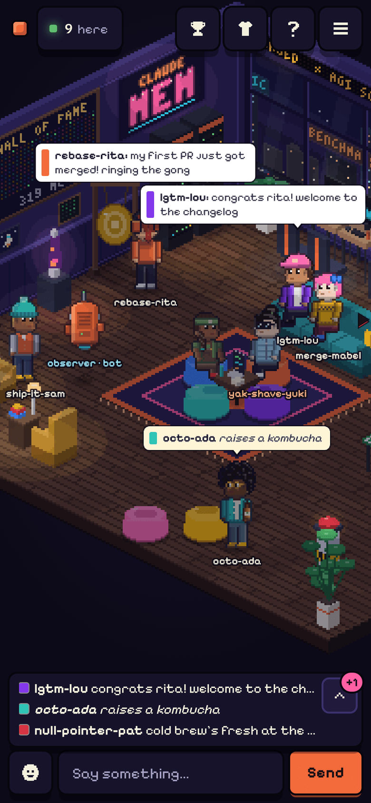
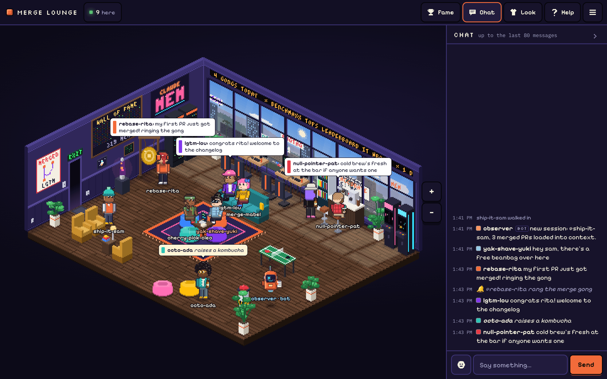

# Merge Lounge

A pixel-art hangout for the people who've merged a PR into your GitHub repo. They check in with their
GitHub username, walk into an isometric dev lounge, and hang out: chat, sit on the beanbags, grab a
kombucha, ring the merge gong when something lands, and watch a made-up startup skyline drift past the window.

Only people with a merged PR in your repo get in. It's one small Node server, no database, no OAuth app.
Fork it, change one config file, deploy it.

The [claude-mem](https://github.com/thedotmack/claude-mem) lounge runs this code with
[`examples/claude-mem.json`](examples/claude-mem.json) — copy it as a starting point for your own text.

<!-- screenshots: added in Phase 5 -->
<!-- Screenshots live in docs/screenshots/ (room on a phone, room on a desktop, the landing page).
<p>
  
  
</p>
<p></p>
-->

## Make one for your project

1. **Copy this repo.** Click **Use this template** on GitHub (or
   [this link](https://github.com/new?template_owner=thedotmack&template_name=merge-lounge&owner=@me&name=my-merge-lounge&visibility=public&description=A+pixel+hangout+for+merged+PR+authors)),
   or fork it.
2. **Edit `lounge.config.json`.** Set `repo` and `admins`. Everything else is worked out from your repo
   name; see [`examples/claude-mem.json`](examples/claude-mem.json) for a fully customised lounge.
   The file is already that small:

   ```json
   { "repo": "you/your-repo", "admins": ["you"] }
   ```

   Want your own sign, billboards or bot lines? Add just those fields (see [Config](#config)).

3. **Deploy to Fly.io.** Install [flyctl](https://fly.io/docs/flyctl/install/) and sign in. Set your app
   name in `fly.toml` (`app = "my-merge-lounge"`), then:

   ```sh
   fly launch --no-deploy --copy-config --region ord
   fly volumes create lounge_state --region ord --size 1
   fly secrets set GITHUB_TOKEN=ghp_xxx   # optional, see below
   fly deploy --ha=false
   ```

   `--ha=false` keeps it to one machine. The lounge keeps its state in files on that one volume, so two
   machines would each have their own room.
4. **Open the URL** Fly prints (`https://<your app name>.fly.dev`). The first boot builds your contributor
   list in the background. It takes a minute or a few, depending on how many PRs your repo has. People can
   check in right away; until the list is ready the server asks GitHub about each person directly.
   Without a token the build uses most of GitHub's 10 searches a minute, so on a repo with thousands of
   PRs, set `GITHUB_TOKEN` before the first deploy, or check-ins may hear "GitHub is busy" until it's done.
5. **Share it.** Post the link in your README, Discord or release notes. Check in yourself first so the
   room isn't empty.

**About `GITHUB_TOKEN`:** it's optional. Without it the server uses GitHub's public limits (10 searches a
minute), which is fine for most projects. A token with no scopes at all raises that to 30 and makes the
first contributor list build about three times faster. Create one at
[github.com/settings/tokens](https://github.com/settings/tokens) and leave every box unticked.

**What it costs on Fly:** a `shared-cpu-1x` machine with 512 MB is about **$3.69 a month** when it runs all
month, and a 1 GB volume about **$0.15 a month**
([Fly pricing](https://fly.io/docs/about/pricing/)). The machine stays on so the room is always open.

## How check-in works

No OAuth, no GitHub permissions. Only public information is used.

1. Someone types their GitHub username. The server looks them up in the contributor list for your repo
   (or asks GitHub's search if they merged after the list was built).
2. They get a one-time code (in the claude-mem lounge it looks like `cmem-lounge-7KQ2PX`; set your own
   start with `codePrefix`) and put it in a **public gist**, either on gist.github.com or from the
   terminal with the `gh gist create` command the check-in page shows them (any file name works).
3. The server spots the code in their public gists and gives that browser a session. The code is tied to
   the browser that asked for it, so nobody can ride along on someone else's gist. They can delete the gist
   afterwards.

## Config

Everything about your lounge lives in `lounge.config.json`. Only `repo` is required. Text you leave out
gets a sensible default, and anything unusable falls back to the default with a warning in the log (so
does an unknown setting, and a `project.url` that points at a different GitHub repo than `repo`, which
usually means the file was copied from someone else's lounge). For a config that sets everything, see
[`examples/claude-mem.json`](examples/claude-mem.json).

<!-- config-table:start -->
| Setting | Default | What it does |
| --- | --- | --- |
| `repo` | required | The GitHub repo whose merged-PR authors get in, as `owner/name`. The `REPO` env var overrides it. |
| `loungeName` | `Merge Lounge` | Name on the landing page, the top bar and the ticker. |
| `project.name` | the repo name (`hello-world`) | Used in the copy: "a merged PR in …", profiles, page title. |
| `project.url` | `https://github.com/you/hello-world` | Footer and menu link. Must start with `https://`. |
| `project.tagline` | empty | Shown when someone taps the neon sign. |
| `admins` | `[]` | GitHub logins with admin commands. The `ADMINS` env var (comma-separated) overrides it. |
| `timezone` | `America/Los_Angeles` | IANA time zone for the window's day and night, the daily counters and the 4am contributor refresh. |
| `neon.top / neon.bottom` | from the repo name (`HELLO` / `WORLD`) | The neon sign. Top line up to 11 characters; the bottom line is drawn big at 4 characters or fewer. |
| `blimp` | from the repo name (`HWORLD`) | Up to 7 characters on the blimp. |
| `skyline.city` | from the time zone (`Los Angeles`) | "The skyline runs on … time." |
| `skyline.names` | 24 made-up startups | Rooftop signs that keep rebranding, up to 10 characters each. |
| `skyline.billboards` | 10 two-line billboards | Freeway billboards: pairs of lines, up to 14 characters each. |
| `ticker` | 6 lines | The LED ticker. Fills in `{contributors}` `{mergedPRs}` `{online}` `{gongs}` `{deploys}` `{loungeName}`; `{gongs:GONG}` gives "3 GONGS". |
| `bot.name` | `observer` | The resident bot. Say its name in chat and it answers. |
| `bot.greet` | 1 line | First visit. Fills in `{login}` and `{merged:merged PR}`. |
| `bot.welcomeBack` | 1 line | Back after 30+ minutes. Fills in `{login}` and `{ago}`. |
| `bot.mention` | 6 lines | Replies when someone mentions the bot. |
| `bot.idle` | 6 lines | Tips it drops now and then. |
| `bot.gong / bot.deploy` | 3 lines / 4 lines | Reactions to the gong and the big red button. |
| `codePrefix` | from the blimp (`hworld-lounge`) | Start of the one-time check-in code people put in a gist. |
| `theme.accent` | `#f26b3a` | Colour of buttons and highlights. |
| `allow` | `[]` | Extra GitHub logins let in without a merged PR. |
| `minMergedPRs` | `1` | How many merged PRs it takes to get in. |
<!-- config-table:end -->

The table is generated from `shared/config.js` (`npm run config-table`), so it always matches the code.
Set `CONFIG_PATH` to keep the config somewhere else; the claude-mem lounge runs with
`CONFIG_PATH=examples/claude-mem.json`. If `REPO` is set to a different repo than the config file names,
the file is ignored completely (so you never end up with someone else's admins or sign).

### Environment variables

| Variable | Default | What it does |
| --- | --- | --- |
| `PORT` | `8080` | HTTP and WebSocket port |
| `STATE_DIR` | `./state` | Where the lounge keeps its files: profiles, sessions, chat history, daily counters and the contributor list. Put it on a volume. |
| `CONFIG_PATH` | `./lounge.config.json` | Where to read the config (the claude-mem lounge: `examples/claude-mem.json`) |
| `REPO` | from the config | Overrides `repo` (see above) |
| `ADMINS` | from the config | Overrides `admins`, comma-separated |
| `GITHUB_TOKEN` | none | Optional. Raises GitHub's search limit from 10 to 30 a minute |
| `CLIENT_IP_HEADER` | none | The header your host's proxy writes the visitor's IP into, for per-visitor limits (Railway: `x-real-ip`, Render: `cf-connecting-ip`). It's the only header read. If it's unset, `Fly-Client-IP` is used on Fly (the server knows it's on Fly from `FLY_APP_NAME`, which Fly sets), and anywhere else no header is trusted, because a visitor could send it themselves: everyone behind the proxy then shares one, more generous, limit. |
| `REFRESH_ON_START` | none | `1` rebuilds the contributor list a few seconds after starting |
| `OFFLINE` | none | `1` makes no GitHub calls at all (check-in lookups answer "GitHub is down"). For the tests. |

### The contributor list

The server keeps the list of everyone with a merged PR at `STATE_DIR/contributors.json`, tagged with the
repo it's for. It builds it on first boot, rebuilds it every day around 4am in your `timezone`, and never
uses a list made for a different repo. `GET /api/status` says where it's at:
`"snapshot": "ready"`, `"building"` or `"missing"` (a build failed; it tries again in 30 minutes).

`STATE_DIR/lounge.json` records which repo the state folder belongs to. Point the same folder at a
different repo and the server clears that lounge's sessions, chat history, daily counters and the people
it found live, so nobody from the old lounge walks into the new one. Profiles (looks, bans) are kept.

To build it by hand: `node scripts/fetch-contributors.js --repo you/your-repo --out state/contributors.json`.
It starts at the date your repo was created and splits the search into smaller date ranges whenever one
range has more than GitHub's 1,000-result limit. Bots are left out of the list but still count toward the
repo's merged-PR total.

## In the lounge

Tap the floor to walk, tap a chair or beanbag to sit, tap people to see their merged PRs, tap the fridge,
the gong or the big red button. Drag to look around, pinch or scroll to zoom.

Chat commands for everyone: `/wave` `/dance` `/sit` `/stand` `/me …` `/w @user …` (whisper) `/who`
`/stats` `/gong` `/afk` `/help`

Admin commands: `/announce …` · `/mute user [minutes]` · `/unmute user` · `/kick user` (2-minute cool-off) ·
`/ban user` · `/unban user` · `/purge user` (delete their chat history) · `/clear` (wipe chat history)

## Other hosts

Any host that runs a Docker image, keeps a WebSocket open and gives you a persistent disk works. Run one
instance, with `STATE_DIR` on the disk.

- **Render:** `render.yaml` in this repo is a Blueprint for one web service with a 1 GB disk at `/data`.
  Disks need a paid plan (the free plan sleeps and has no disk). Use
  `https://render.com/deploy?repo=https://github.com/YOU/your-lounge` as a deploy button link.
  The Blueprint sets `CLIENT_IP_HEADER=cf-connecting-ip`: Render's
  [own guide](https://render.com/articles/host-pocketbase-on-render) says Cloudflare writes that header on
  every request to a Render web service and overwrites whatever the caller sent. (It's a guide, not
  Render's reference docs.) If your service ever stops seeing it, unset `CLIENT_IP_HEADER`: everyone then
  shares one, more generous, limit instead of each visitor getting their own.
- **Railway:** it builds the `Dockerfile` on its own. Add a volume with `railway volume add --mount-path /data`
  and set `STATE_DIR=/data` and `CLIENT_IP_HEADER=x-real-ip` (plus `GITHUB_TOKEN` if you like).
- **A VM or a Fly Sprite:** copy the repo, run `npm ci`, and run the server as a service with a small
  `start.sh` that sets the environment and starts it:

  ```sh
  #!/bin/sh
  cd /path/to/lounge
  export PORT=8080 STATE_DIR=/path/to/lounge-state
  # export CONFIG_PATH=examples/claude-mem.json   # how the claude-mem lounge runs
  exec node server.js
  ```

  Leave `CLIENT_IP_HEADER` unset on a Sprite: which header its proxy puts the visitor's address in isn't
  documented, so the server trusts none, and everyone shares one, more generous, limit. On a VM behind
  your own proxy, set it to the header that proxy writes (often `x-real-ip`).

## Run it locally

```sh
npm install
node server.js            # reads lounge.config.json, keeps state in ./state
CONFIG_PATH=examples/claude-mem.json node server.js   # the same code with claude-mem's full text
```

Open http://localhost:8080. Add `?tod=21` to force the time of day for the skyline, and `?debug=1` to get
`window.__lounge` in the console.

To get into the room without a gist while developing, mint a session for a throwaway `test-*` user
(with the server stopped, so a pending save can't overwrite it), then put the token in the browser's
localStorage as `mergeLounge.token`:

```sh
node scripts/mint-session.js test-ada      # prints {"test-ada":"<token>"}
node scripts/purge-test.js                 # later: remove every trace of test-* users (server stopped)
```

## Tests

```sh
npm test                  # config + search-window unit tests, the smoke test, the crash fuzzer
OFFLINE=1 npm test        # the same with no GitHub calls at all (the few checks that need GitHub are skipped)
```

The smoke and fuzz tests start their own server on a free port with a throwaway state folder, a test
config and a tiny fake contributor list, so they never touch your real state. `TEST_PORTS=8401-8409`
keeps them inside a port range. CI (`.github/workflows/ci.yml`) syntax-checks every JS file and runs
`OFFLINE=1 npm test`.

## How it's built

- One Node process (Node 20 or newer): static files, a small JSON API and one WebSocket room. The only
  dependency is `ws`. No build step.
- No database: a few JSON files in `STATE_DIR`, written atomically.
- All the art is drawn in code, with no image assets besides the favicon. Fonts: Silkscreen, Pixelify Sans and IBM Plex Mono (OFL,
  in `public/fonts`).
- `shared/world.js` (the room) and `shared/config.js` (the settings) are used by both the server and the browser.

## License

MIT, see [LICENSE](LICENSE). Keep the copyright notice in your fork.
